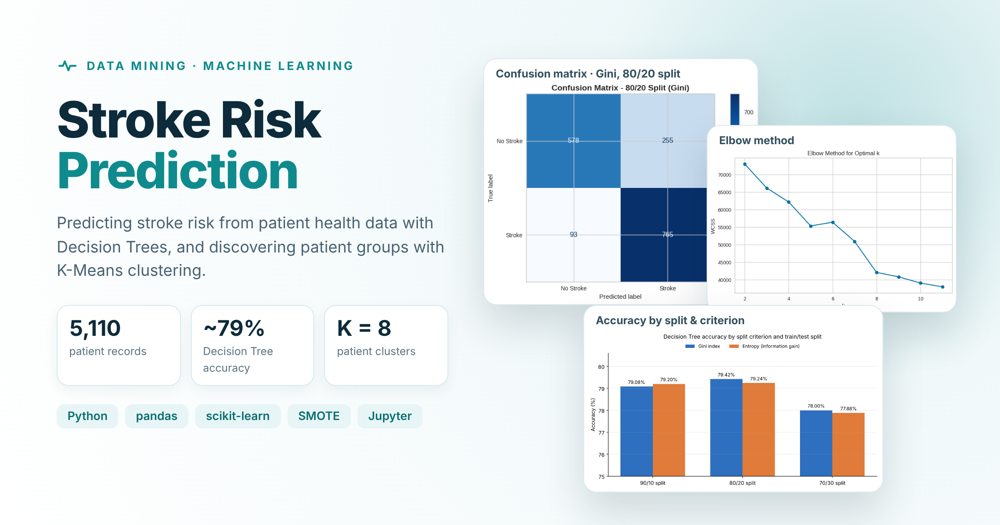
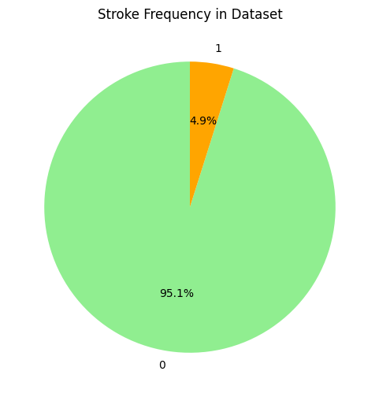
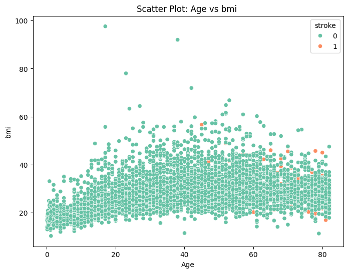
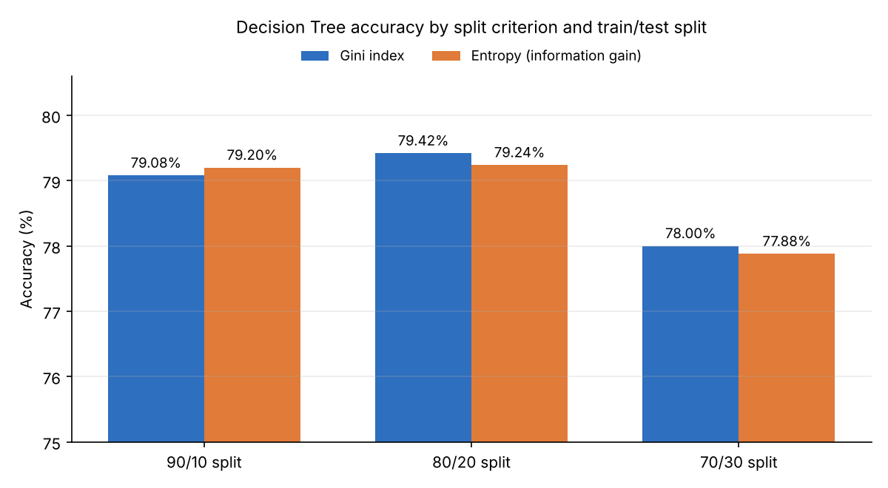
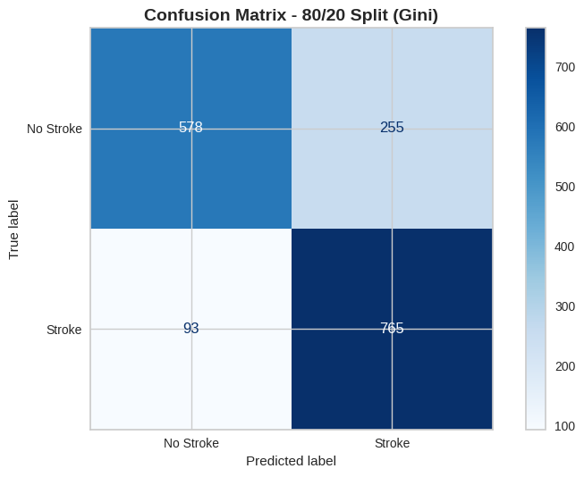
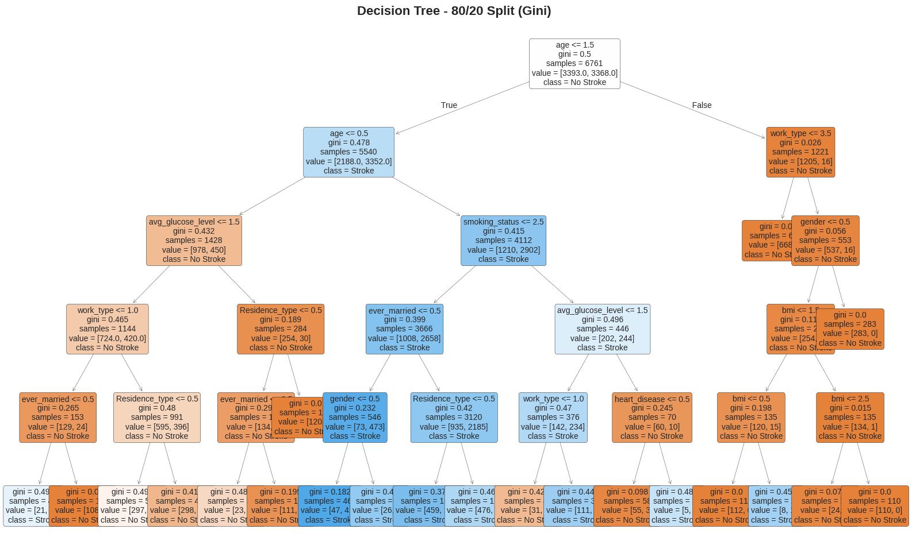
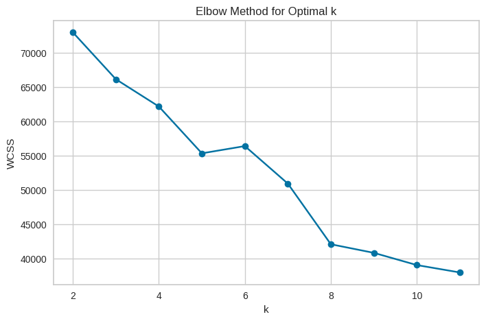
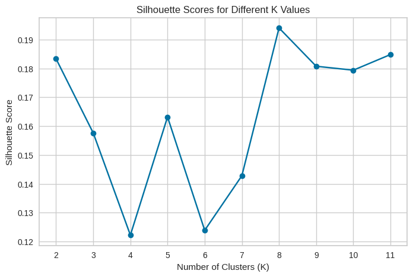
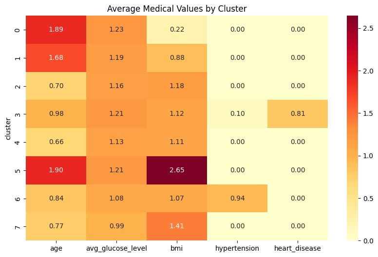

# Stroke Risk Prediction 🩺

**A data mining project that predicts stroke risk from patient health data and discovers groups of patients with similar health profiles.**




### [▶ Open the full analysis in Google Colab](https://colab.research.google.com/github/leen686/IT326-Stroke-Prediction/blob/main/Reports/phase3.ipynb)

## Overview

According to the World Health Organization, stroke is the second leading cause of death worldwide. Many strokes are linked to risk factors that can be measured early, such as age, hypertension, heart disease, glucose level and BMI.

This project applies two data mining tasks to a real patient dataset:

- **Classification:** a Decision Tree model that predicts whether a patient is likely to have a stroke.
- **Clustering:** K-Means, which groups patients with similar health characteristics to reveal hidden risk patterns.

Developed by a four-member team for the **Data Mining (IT326)** course at **King Saud University**, Fall 2025.

## Highlights

- **End-to-end pipeline:** exploration, cleaning, encoding, discretization, balancing, modelling and evaluation
- **6 Decision Tree experiments** comparing two split criteria (Gini index and entropy) across three train/test splits
- **Class imbalance handled with SMOTE:** only 4.9% of patients in the data had a stroke
- **Optimal number of clusters selected with evidence**, using the elbow method, silhouette scores and silhouette plots
- **Results compared with a published research paper** on stroke prediction

## Dataset

[Stroke Prediction Dataset](https://www.kaggle.com/datasets/fedesoriano/stroke-prediction-dataset) from Kaggle: **5,110 patient records** with 11 attributes, including gender, age, hypertension, heart disease, marital status, work type, residence type, average glucose level, BMI and smoking status. The target is `stroke` (1 = stroke, 0 = no stroke).

| Class imbalance | Age vs. BMI by stroke |
|---|---|
|  |  |

Only 249 of 5,110 patients (4.9%) had a stroke, and stroke cases appear far more often in older patients.

## Approach

1. **Exploration:** five-number summaries, box plots, histograms and bar charts to understand distributions, outliers and missing values.
2. **Preprocessing:**
   - Filled 201 missing BMI values with the mean
   - Removed outliers in average glucose level and BMI
   - Encoded categorical attributes as numbers
   - Grouped age, glucose and BMI into meaningful ranges (discretization)
   - Dropped the `id` column
3. **Balancing:** applied SMOTE so the model would not simply predict "no stroke" for everyone.
4. **Classification:** Decision Trees (`max_depth = 5`) with Gini index and entropy, each tested on 90/10, 80/20 and 70/30 train/test splits.
5. **Clustering:** scaled the features, then ran K-Means and compared K = 2 to 11 using the elbow method and silhouette scores.

## Results

### Classification

| Split criterion | 90/10 split | 80/20 split | 70/30 split |
|---|---|---|---|
| Gini index | 79.08% | **79.42%** | 78.00% |
| Entropy (information gain) | 79.20% | 79.24% | 77.88% |



- Accuracy stayed **stable at 78–79%** across every split and both criteria, so the model's behaviour is consistent.
- The best model, Gini index with an 80/20 split, caught **89% of stroke cases** (765 of 858) in the test set.
- **Age** was the most important factor, followed by **average glucose level, hypertension and BMI**, which matches known medical risk factors.

| Confusion matrix (Gini, 80/20) | Decision tree (Gini, 80/20) |
|---|---|
|  |  |

### Clustering

| Elbow method | Silhouette scores |
|---|---|
|  |  |

**K = 8** gave the best cluster quality (silhouette score 0.194, the highest of all tested values), and the elbow curve flattens after it. The cluster profiles below show groups with distinctly higher age, glucose or BMI, the same factors the Decision Tree relied on.



## Limitations and next steps

- **Balancing before splitting:** SMOTE was applied to the whole dataset before the train/test split, so synthetic stroke samples also appear in the test set. This likely makes the reported accuracy optimistic. Applying SMOTE only to the training data would give a more realistic estimate.
- **Accuracy is not the whole story:** for medical screening, missing a stroke is worse than a false alarm, so recall and precision for the stroke class matter more than overall accuracy.
- **Next steps:** try models such as Random Forest or gradient boosting, tune decision thresholds for higher recall, and evaluate with cross-validation.

This is an academic project for learning purposes and is not a medical tool.

## Project structure

| Path | Contents |
|---|---|
| `Reports/phase1.ipynb` | Problem definition and dataset description |
| `Reports/phase2.ipynb` | Exploration and preprocessing |
| `Reports/phase3.ipynb` | Full project: classification, clustering, evaluation and report |
| `Data_Set/Raw_DataSet.csv` | Original Kaggle dataset |
| `Data_Set/processed_data.csv` | Cleaned dataset after preprocessing |
| `assets/` | Charts used in this README |

## Run it

Open [`Reports/phase3.ipynb`](https://colab.research.google.com/github/leen686/IT326-Stroke-Prediction/blob/main/Reports/phase3.ipynb) in Google Colab, or run it locally with Jupyter:

```bash
pip install pandas numpy matplotlib seaborn scikit-learn imbalanced-learn yellowbrick
jupyter notebook Reports/phase3.ipynb
```

## Team

- Noura Altuwiam
- Leen Almutairi
- Juri Alzahem
- Lama Alhamed

*Data Mining (IT326) — King Saud University, 2025*

## References

1. F. Soriano, "Stroke Prediction Dataset," Kaggle.
2. P. Chakraborty et al., "Predicting stroke occurrences: a stacked machine learning approach with feature selection and data preprocessing."
